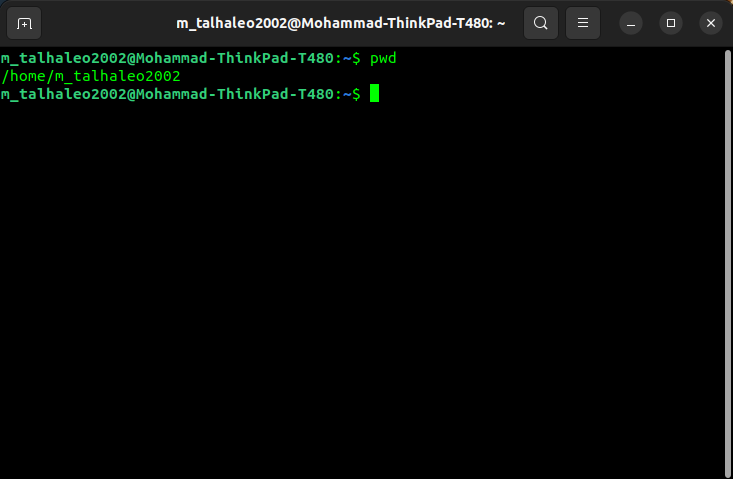
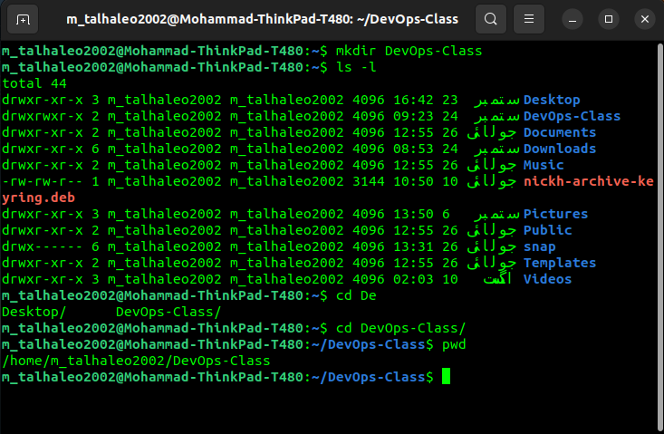
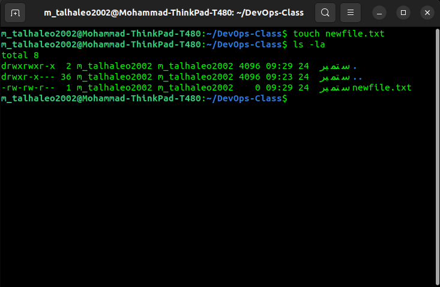
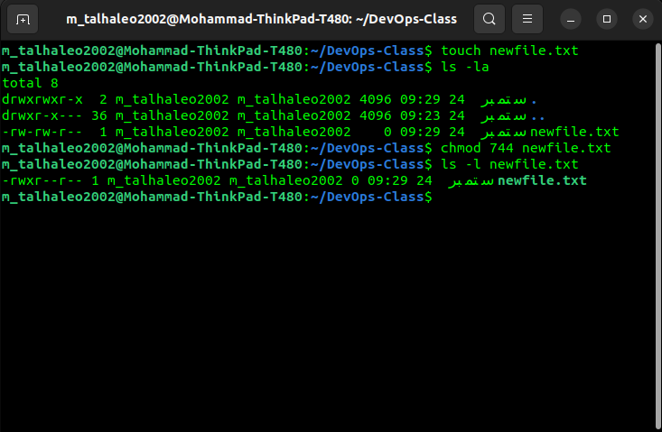
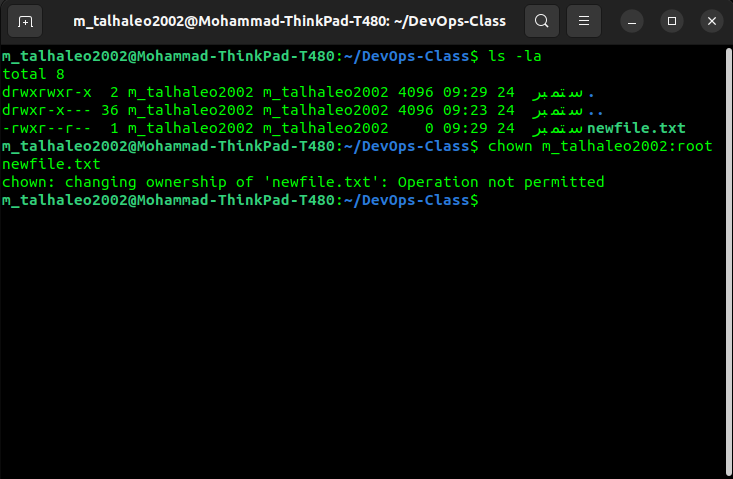
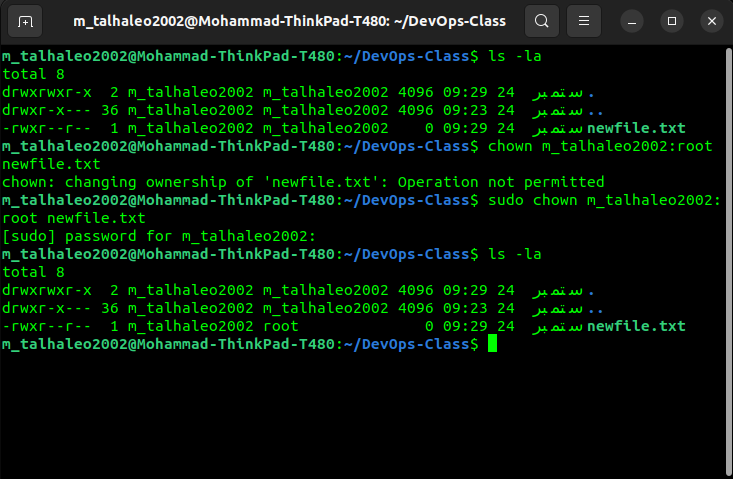

# Lecture 01: Linux Fundamentals, Permissions & Commands

**Course:** DevOps Training 2026  
**Instructor:** Sir Nabeel  
**Date:** 27 March 2026

This lecture introduces navigation in the Linux terminal, file and directory creation, ownership, permissions, and administrative privileges. Run the examples in a practice directory under your own home directory.

## 1. Where am I? `pwd`

```bash
pwd
```

`pwd` means **print working directory**. It displays the absolute path of your current directory. For example:

```text
/home/m_talhaleo2002
```

The initial `/` is the **root directory** of the Linux filesystem. It is separate from a user's home directory, which is typically `/home/USERNAME`. `~` is shorthand for the current user's home directory. Windows commonly displays a user's files under `C:\Users\USERNAME`, but Linux's `/` is only a rough analogy to a drive root: Linux mounts other filesystems into the same directory tree.



## 2. List files: `ls`

```bash
ls
ls -l
ls -la
```

`ls` lists directory entries. `-l` displays details; `-a` also includes hidden names beginning with `.`. A long listing might look like this:

```text
drwxr-xr-x 2 m_talhaleo2002 m_talhaleo2002 4096 Jul 26 12:55 Desktop
-rw-rw-r-- 1 m_talhaleo2002 m_talhaleo2002 3144 Jul 10 10:50 nickh-archive-keyring.deb
```

From left to right: **file type and permissions**, **hard-link count**, **owner user**, **owner group**, **size in bytes**, **last modification date and time**, and **name**. The displayed date may use your system locale. `d` at the start means directory; `-` means regular file.

## 3. Read permissions

The first character shows the file type; the next nine characters form three sets:

```text
d  rwx  rwx  r-x
│   │    │    └─ others
│   │    └────── group
│   └─────────── owner user
└─────────────── directory
```

`r` means read, `w` means write, and `x` means execute or access. A missing permission appears as `-`. For a **regular file**, `x` allows execution if the file is a runnable program or suitable script. For a **directory**, `x` allows traversal into it; directory `r` allows listing its names, and `w` permits modifying entries when directory access also allows it. Thus, `drwxrwxr-x` is a directory where the owner and group have `rwx`, while others have `r-x`.

Files have an owner user and an owner group. On many Linux installations, creating a user also creates a group of the same name, but this depends on the system configuration. Group permissions apply to members of the file's **actual owning group**; creating an unrelated group and adding a user to it does not automatically grant access to the file. Everyone else falls under `others` (subject also to ACLs and other access controls).

## 4. Create a directory and enter it

```bash
mkdir DevOps-Class
ls -l
cd DevOps-Class
pwd
```

`mkdir` creates a directory. `cd` changes the working directory. If you started in your home directory, `pwd` now shows something like `/home/m_talhaleo2002/DevOps-Class`.



The shell prompt might show `m_talhaleo2002@Mohammad-ThinkPad-T480:~/DevOps-Class$`: the username, hostname, and abbreviated current location. Its exact appearance depends on shell configuration.


## 5. Create a file

```bash
touch newfile.txt
ls -la
```

`touch` creates an empty file if it does not exist. If it exists, it updates its timestamps. A new file may appear with permissions such as `-rw-rw-r--`; defaults vary with your `umask`, filesystem, and configuration.



## 6. Change permissions: `chmod`

Numeric permissions assign `r = 4`, `w = 2`, and `x = 1`. Add the values separately for owner, group, and others:

| Permissions | Value | Meaning |
| --- | ---: | --- |
| `rwx` | 7 | Read, write, execute |
| `rw-` | 6 | Read, write |
| `r-x` | 5 | Read, execute |
| `r--` | 4 | Read only |

```bash
chmod 744 newfile.txt
ls -l newfile.txt
```

`744` gives the owner `rwx`, the group `r--`, and others `r--`: `-rwxr--r--`. The `x` bit by itself does not turn an empty text file into a working script. Numeric modes are one option; `chmod` also accepts symbolic modes such as `chmod u+x script.sh`.



## 7. Change ownership: `chown` and `sudo`

```bash
sudo chown m_talhaleo2002:root newfile.txt
ls -l newfile.txt
```

The format is `chown USER:GROUP FILE`. This example changes the owner user to `m_talhaleo2002` **and** the owning group to `root`; `m_talhaleo2002` must exist on the system. To retain the current owner and change only the group, use `sudo chown :root newfile.txt`. Changing ownership usually requires administrative privileges; without them, `chown` may report `Operation not permitted`.



`sudo` runs a command with permitted elevated privileges, commonly as `root`, and may ask for your password. `root` is the administrative user; a `root` group also exists. Use an ordinary practice group for real shared files: changing a learning file to the `root` group is only a demonstration.



## Quick reference

| Command | Purpose |
| --- | --- |
| `pwd` | Print the current directory |
| `ls`, `ls -l`, `ls -la` | List files; show details; include hidden entries |
| `mkdir NAME` | Create a directory |
| `cd NAME` | Enter a directory |
| `touch FILE` | Create an empty file or update timestamps |
| `chmod 744 FILE` | Set owner/group/other permissions |
| `sudo chown USER:GROUP FILE` | Change owner and group with privileges |

## Screenshots

Place the original screenshots in an `images` folder beside this README and keep the filenames and capitalization exactly as shown below:

```text
Lecture 01 - Linux Fundamentals - 27 Mar 2026/
├── README.md
└── images/
    ├── pwd.png
    ├── Make_Directory.png
    ├── cd-devops-class.png
    ├── Again-pwd.png
    ├── touch-file.png
    ├── chmod.png
    ├── chown.png
    └── chownsudo.png
```

Markdown syntax is ``. These are relative links, so the README and `images` folder must stay together. On Linux, filename case matters. If a screenshot has a different actual name or extension, change the link to match it.
